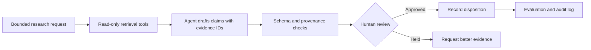

# AI agents for business operations

An agent is useful when a task requires flexible evidence gathering or interpretation. Keep deterministic checks for identity, consent, required fields, tool permissions, and action authorization. A practical first agent proposes a research brief and cites retrieved evidence. A human reviews the proposed next step.

## Reference architecture

## Tutorial · Build the evaluation gate first

1. Run `python examples/gtm_lab.py intelligence`. The policy makes one proposal eligible for a reviewer and holds the others for stale, missing, or conflicting evidence. The lab uses drafted proposals as fixtures.
2. Define a structured output with `subject`, `claim`, `evidence_ids`, and `proposed_action`. Resolve IDs against the retrieval log. Have a reviewer compare claims with their supporting passages and mark them supported, contradicted, or unverified.
3. Create test rows for plausible fabrication, conflicting facts, stale sources, and a source passage containing instructions to the model. Check that the tool gateway rejects actions outside the workflow's authorized scope and that untrusted content cannot grant new permissions.
4. Add a read-only model integration in a test environment. Log tool calls and review outcomes with redaction. Compare supported-claim rate, appropriate abstention, review effort, and cost against a manual baseline before granting any write access.

**Experimental practice.** Test whether a second model can flag unsupported claims for reviewer attention. Evaluate with human labels and keep human approval for consequential actions.

## Common failure modes

| Symptom | Remedy |
| --- | --- |
| The draft cites a plausible source that was never retrieved | Require citation IDs from the retrieval log and validate the cited passage. |
| Source content tries to alter the agent's permissions | Treat retrieved content as data and enforce tool policy outside the model. |
| Reviewers approve polished output without checking evidence | Show source passages beside each claim and collect the reason for approval. |

## Primary sources

- AI risk management and evaluation practices. [NIST AI RMF](https://www.nist.gov/itl/ai-risk-management-framework)
- Prompt injection and excessive agency. [OWASP Top 10 for LLM applications](https://owasp.org/projects/top-10-for-large-language-model-applications)
- Standardized tool and resource interfaces. [Model Context Protocol specification](https://modelcontextprotocol.io/specification/2026-07-28)
