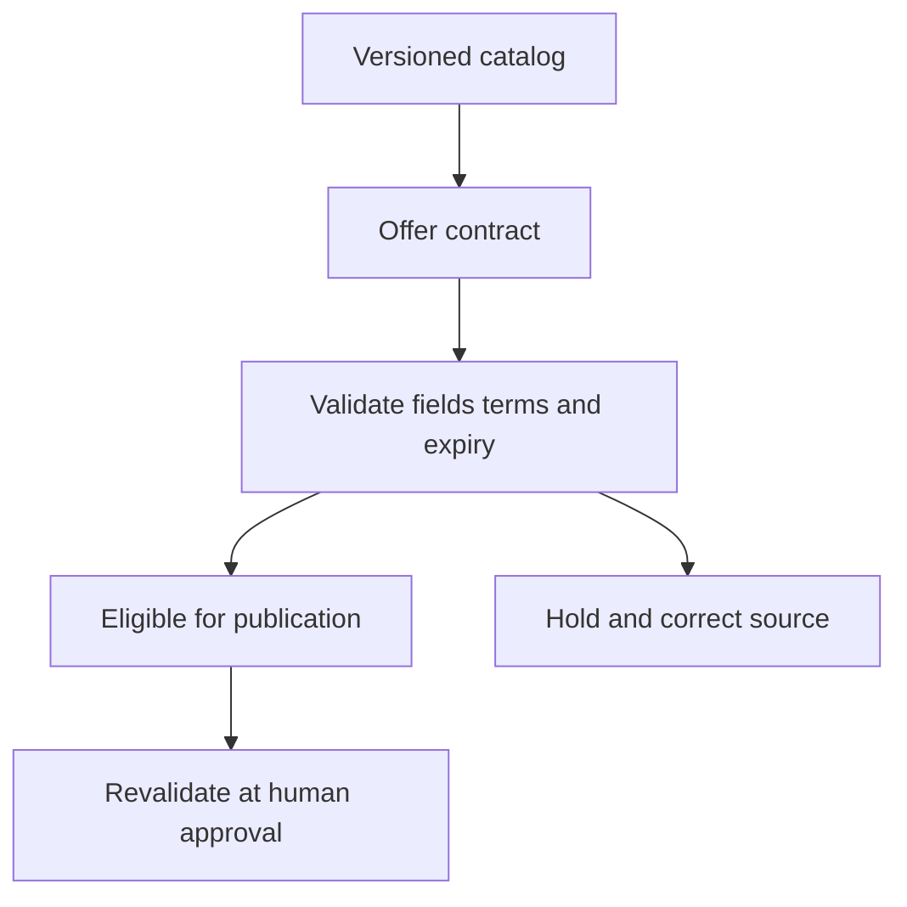

# Validate offers for AI-assisted buying

A buyer or assistant needs enough structured information to explain an offer accurately. Price versions, currency, billing periods, terms, and expiry must be consistent before a quote enters an approval path.

## Architecture and contracts

The synthetic file `examples/fixtures/offers.json` passes an offer ID, product ID, price version, integer amount in minor units, currency, billing period, expiry timestamp, and terms URL. The policy supplies allowed currencies and periods, and fixes the comparison clock.

## Reproduce and verify

1. Run `python examples/gtm_lab.py offers`. The USD monthly offer passes. The EUR annual offer reports `expired` and `invalid_terms_url`.
2. Copy the fixtures and repair the annual offer using an expiry after the sample policy clock and a valid HTTPS URL on a reserved domain. Run `python examples/gtm_lab.py offers --fixtures PATH`. The offer then passes. Set its minor-unit amount to a negative integer. Expect `invalid_amount_minor`.
3. Compare the fixture against the [commerce guide](../commerce.md) and write down which fields belong in discovery and which are required in a binding quote. Run `python -m unittest discover -s tests -p test_lab.py -v` to verify the recorded failures.

## Security, recovery, and scope

Confirm offer eligibility, immutable version, and authorized human approval before a commitment. When terms change, invalidate the old quote and request a fresh approval. This exercise lints local files and never crawls, validates a checkout session, or makes a purchase.

The [GTM AI Buyer Readiness](https://github.com/stephenstilwell/gtm-ai-buyer-readiness) companion examines buyer-facing HTML, structured data, feeds, and advertised UCP profiles. Its readme documents two offline sample audits. Compare their evidence and findings before considering an authorized live audit. Its audit does not verify transaction compatibility.

Use [Schema.org Offer](https://schema.org/Offer) to map public offer fields, then compare discovery and negotiation boundaries in the [Universal Commerce Protocol specification](https://ucp.dev/2026-08-25/specification/overview/).
