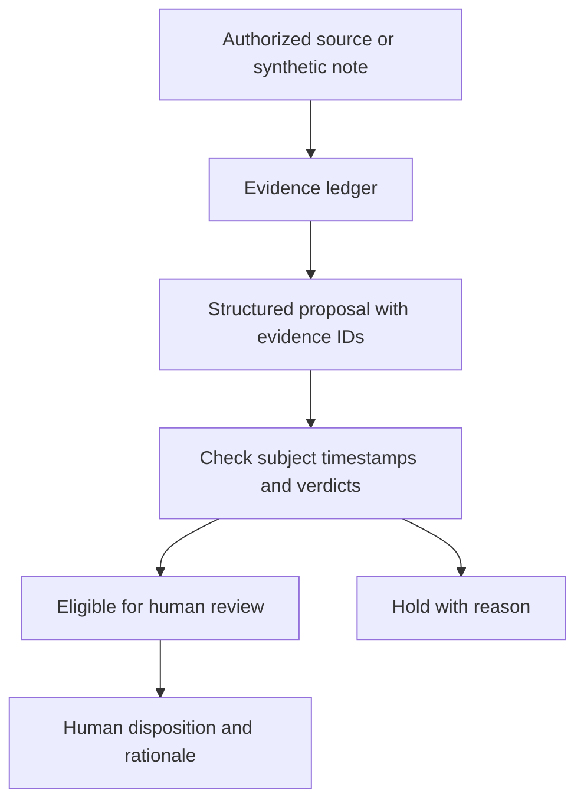

# Evidence and review pipelines

Company research, qualification, partner evaluation, and vertical discovery all require claims the reviewer can trace. The pipeline should hold a claim when the source is missing, stale, contradictory, or about a different subject.

## Architecture and contracts

In `examples/fixtures/intelligence.json`, each evidence row carries an ID, subject, retrieval timestamp, source URL, verdict, and notes. A proposal carries a subject, claim, action, and referenced evidence IDs. The lab checks references and policy. A reviewer still needs enough source text to assess whether a verdict is justified.

## Reproduce and verify

1. Run `python examples/gtm_lab.py intelligence`. `partner-review` is eligible for review. The other proposals are held for stale (`vertical-review`), conflicting (`product-market-review`), and missing evidence (`agent-draft`).
2. For **company research and AI-assisted qualification**, copy the fixtures and add a synthetic note with ID `missing-note`, the same subject as `agent-draft`, a fresh timestamp, an HTTPS `.example` URL, and verdict `supports`. Run with `--fixtures PATH`. Expect `eligible_for_review`. Change the subject on that note. Expect `invalid_provenance`.
3. For **partnership matching**, add a fresh contradiction to `partner-review` and reference its ID. Expect `conflicting_evidence` even when the original supporting note remains.
4. For **industry opportunity intelligence**, add a fresh, scoped corroborating note to `vertical-review` while preserving the old one. Compare the number of fresh supporting references and record which population your note covers. Relevance and industry coverage remain editorial decisions.
5. Run `python -m unittest discover -s tests -p test_lab.py -v`. Evidence freshness, provenance, and conflict checks have regression coverage.

## Security, recovery, and scope

Use approved public, synthetic, or permissioned records with source-level access controls. Treat retrieved material as untrusted input. Keep tool permissions, suppression, and any external action under deterministic policy. Recover a held proposal by retrieving independent evidence or correcting a bad identity mapping, then preserve the earlier decision in your audit history. The offline example contains drafted proposals and hand-labeled verdicts. It makes no model calls and makes no decision to contact a person.

Read [AI agent oversight](../agents.md), [partnership intelligence](../partnerships.md), or [vertical intelligence](../verticals.md) for different review thresholds and sampling concerns.

For primary guidance on review and tool boundaries, consult [NIST AI RMF](https://www.nist.gov/itl/ai-risk-management-framework) and the [OWASP Top 10 for LLM applications](https://owasp.org/projects/top-10-for-large-language-model-applications).
