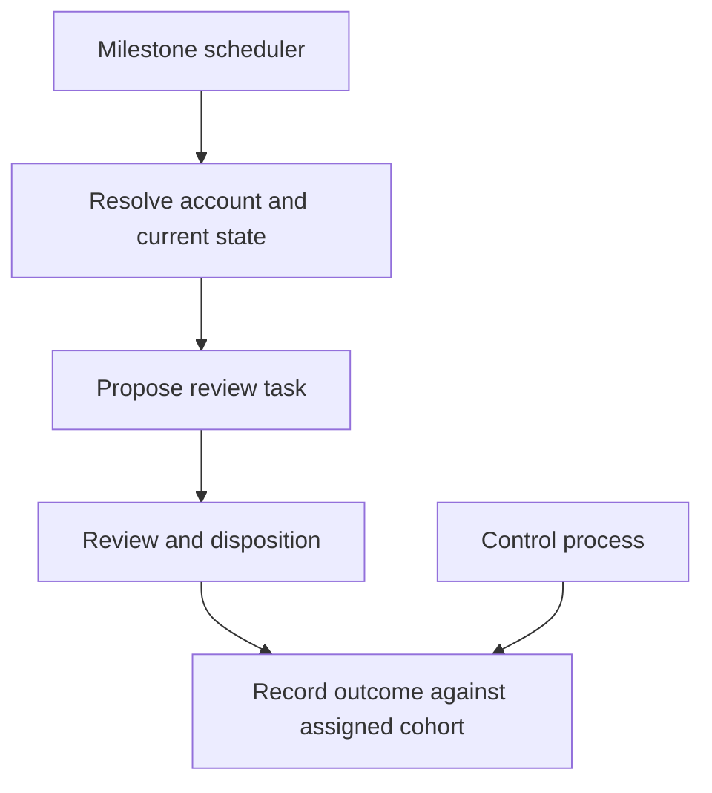

# Lifecycle monitoring and measurement

A customer team needs follow-up when a real onboarding milestone is missed. The same team needs to know whether the workflow improves qualified activation and whether it creates a manageable review load.

## Architecture and contracts

The routing fixture includes `onboarding.milestone_due` and an assigned owner. In a live system give the milestone instance its own stable ID, deadline, and cancellation rule. The separate measurement fixture carries one observed boolean outcome and one assignment per account. Document the outcome and its measurement window before assignment.

## Reproduce and verify

1. Run `python examples/gtm_lab.py routing`. Find `review_onboarding_milestone` for `synthetic-404`. In a scratch fixture copy, set `account-404` to suppressed. With `--fixtures PATH`, expect `blocked` and no onboarding task.
2. Run `python examples/gtm_lab.py measurement`. The synthetic groups record two conversions out of four treated accounts and one out of four controls. The 25-percentage-point difference illustrates contribution and workflow cost arithmetic with a fixed policy.
3. In the measurement copy, duplicate a single account in the other group. Expect the command to fail with `repeated assignment`. Recover by inspecting original enrollment and preserving the authoritative assignment. For a live trial, handle missing outcomes explicitly rather than flipping them to false.
4. Run `python -m unittest discover -s tests -p test_lab.py -v`. The suite checks task type, suppression, ROI arithmetic, and repeated assignment.

## Security, recovery, and scope

Restrict access to cohort assignments and outcome logs. At action time, close or hold work when current account state says the milestone was completed or the customer withdrew. The lab routes a supplied milestone rather than implementing an onboarding state machine. The trial fixture teaches arithmetic and has no causal inference or rollout conclusion. Use the [lifecycle guide](../lifecycle.md) and [experiment chapter](../measurement.md) to design the live process.

Compare the scheduler’s synthetic event with documented subscription transitions in [Stripe Billing webhooks](https://docs.stripe.com/billing/subscriptions/webhooks).
