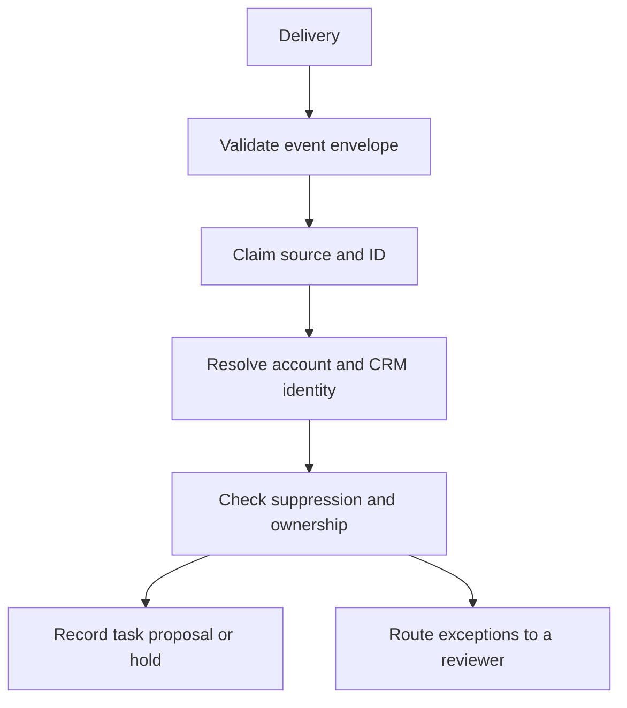

# Signal-to-opportunity routing

An inbound request should produce a task that a named owner can review, even if the sender retries. A stale signal, a blocked account, or a disputed identity needs a legible decision. Opening an opportunity is a separate business action after qualification.

## Architecture and contracts

The event contract is in `examples/config/signal.schema.json`. The fixture `examples/fixtures/routing.json` supplies the synthetic event, account ID, CRM company ID, owner, and suppression state. A task proposal stores the source and ID, CRM company ID, owner, and action. Decide who is allowed to resolve matches or change owners before allowing writes.

## Reproduce and verify

1. Run `python examples/gtm_lab.py routing`. Expect seven deliveries, one exact duplicate, six decisions, and two task proposals. The demo and onboarding records produce different actions.
2. Copy `examples/fixtures` to a scratch directory. Append an exact copy of `demo-101` to the routing deliveries. Run `python examples/gtm_lab.py routing --fixtures PATH`. Expect one more duplicate and the same tasks.
3. Give another copy the same source and ID but a different account subject. Rerun. Expect a conflict in `payload_conflicts`, with the original decision and task count unchanged. Quarantine such collisions and ask the producer to identify the authoritative delivery before any replay.
4. Remove `crm_company_id` from `account-101` in the copy. The next run holds its task. An operator should resolve the identity rather than guess by name. To simulate a merge, update an approved ID mapping, preserve the historical IDs for audit, then reconcile the proposal against current CRM state.
5. Run `python -m unittest discover -s tests -p test_lab.py -v`. Replay, cross-source identity, payload conflicts, suppression, and CRM ownership have regression coverage.

## Security, recovery, and scope

Validate source authenticity in a live adapter and recheck suppression before a remote action. A timeout can arrive after the remote task was written. Look up its stable action key and reconcile before retrying. The lab’s in-memory store resets per run and never creates a real opportunity or merges CRM records. See [event delivery](../signals.md) and [CRM authority](../crm.md).

To inspect a broader signal collection and scoring implementation, run the synthetic demo in [GTM Signal Lab](https://github.com/stephenstilwell/gtm-signal-lab). Its readme documents CSV/JSON imports and approved public sources. The handbook exercise focuses on the later delivery and ownership boundary.

The event contract follows the source and ID semantics described in [CloudEvents 1.0.2](https://github.com/cloudevents/spec/blob/v1.0.2/cloudevents/spec.md).
