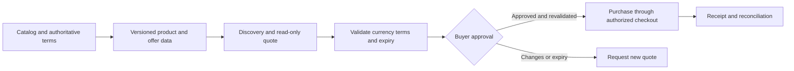

# Agentic commerce and AI buyer readiness

AI buyer readiness is the ability for software to discover an offer, understand its terms, and reach a clear human-approved buying path. Start with public product facts, explicit price units, currency, eligibility, and a terms URL. Bind commitments to the seller's authoritative price and terms at the time of approval.

## Reference architecture

## Tutorial · Validate a machine-readable offer

1. Run `python examples/gtm_lab.py offers`. Inspect the valid USD monthly offer and the expired EUR annual offer. The latter produces two reason codes, `expired` and `invalid_terms_url`.
2. In a copy of the fixture, repair the expiry and terms URL. Change `billing_period` to an unsupported value and observe the corresponding validation issue.
3. Map the lab fields into a discovery representation using Schema.org Product and Offer. Use explicit price, currency, and canonical product references. Keep local acceptance fields such as the immutable offer ID, billing period, and approved terms in your versioned quote contract. The lab fixture uses a small local contract.
4. Test the buying path with an expired quote, an ineligible buyer, and a changed price. At checkout, revalidate the offer and show the total commitment, renewal terms, and order confirmation before recording the purchase.

**Experimental practice.** Trial a read-only comparison tool that exposes quote expiry and separates recurring price from total cost. Evaluate misquotes and human corrections before allowing downstream purchase requests.

For an interoperability exercise, read the Universal Commerce Protocol profile and capability negotiation sections. Mark which capabilities your hypothetical seller could advertise today and which would require building or integrating checkout. Record the protocol version and distinguish the public discovery payload from the authoritative merchant quote used for approval.

## Common failure modes

| Symptom | Remedy |
| --- | --- |
| Monthly and annual prices get compared as equal amounts | Publish duration, currency, included units, and fee treatment with every price. |
| A cached offer reaches checkout after expiration | Use an expiration timestamp and confirm authoritative terms before commitment. |
| Machine-readable pricing and checkout disagree | Generate both from one catalog version and reconcile on publication. |

## Primary sources

- Discovery vocabulary and property semantics. [Schema.org Product](https://schema.org/Product) · [Schema.org Offer](https://schema.org/Offer)
- Capability discovery, negotiation, and checkout boundaries. [Universal Commerce Protocol specification](https://ucp.dev/2026-08-25/specification/overview/)
- HTTP representations, conditional requests, and method semantics. [RFC 9110](https://www.rfc-editor.org/rfc/rfc9110.html)
