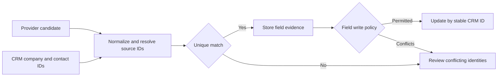

# CRM data models and enrichment

A CRM stores records such as companies, contacts, and deals, plus the associations between them. Enrichment adds observations about those records, such as a company size estimate or a verified domain. An enriched value needs a source and observation date. Whether it becomes an authoritative CRM value is a separate policy decision.

## Reference architecture

## Tutorial · Map identity and stage enrichment

1. From `examples/fixtures/routing.json`, record each account's internal ID and CRM ID in a table. Extend the exercise with a mock contact who belongs to two companies in different roles. Represent the roles on associations instead of embedding a single company name on the contact.
2. Create a staging row with `account_id`, `candidate_field`, `candidate_value`, `source`, `observed_at`, and `match_status`. Give the same account two conflicting size estimates. Mark the field for review and preserve both observations.
3. Run `python examples/gtm_lab.py routing` and inspect the CRM company ID on each task. In a copy of the fixture, remove one eligible account's CRM ID and re-run. That account moves to `manual_review`.
4. Draw a field authority matrix. Provider estimates may fill an empty descriptive field when identity matches. Account owner, lifecycle stage, and suppression should be written by their approved process.

Track fill rate alongside audited match quality and provider cost per accepted field. Audit a sample of accepted and rejected matches.

## Common failure modes

| Symptom | Remedy |
| --- | --- |
| Two companies sharing a website merge into one record | Treat a normalized domain as a candidate key and require independent confirmation. |
| A blank provider result erases a populated value | Distinguish unknown, observed empty, and an authorized clear operation. |
| Confidence scores disagree across providers | Evaluate match rules on a labeled set and retain each provider's evidence. |

## Primary sources

- Object and association model. [HubSpot CRM model](https://developers.hubspot.com/docs/api-reference/latest/crm/understanding-the-crm)
- Provider fallback and waterfall concepts. [Clay waterfalls](https://university.clay.com/docs/building-a-data-waterfall)
- Identity constraints at the storage layer. [PostgreSQL constraints](https://www.postgresql.org/docs/current/ddl-constraints.html)
