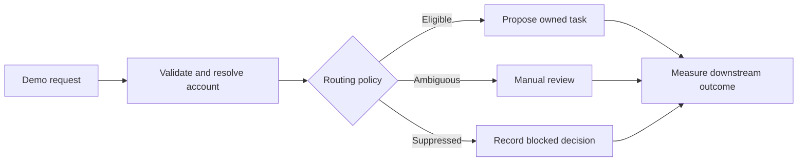

# GTM engineering fundamentals

GTM engineering turns go-to-market work into reliable, observable systems. Start with a decision someone already makes, such as assigning an inbound demo request. Write down the inputs, policy, action, and outcome before choosing a tool. Revenue operations usually defines the process and ownership rules. Engineering implements the integrations, tests, and observability that make those rules enforceable.

## Reference architecture

## Tutorial · Write the first workflow contract

Consider a hypothetical inbound queue with duplicate demo requests and missing owners. The request should result in an internal task when the account is eligible and an owner can be resolved.

1. Record the trigger, required fields, decision policy, owner, and success metric. Use an event ID supplied by the intake system and an internal account ID supplied by identity resolution.
2. Define the fallback for a missing owner, the effect of suppression, and the acceptable time from intake to first review. Agree who owns that review queue.
3. Run `python examples/gtm_lab.py routing`. Find the demo request in the decisions, then match its source and ID to the task. Compare it with the unassigned account and the suppressed account.
4. For a workflow you own, write the contract in plain language and ask a colleague to predict outcomes for those three cases before seeing the implementation.

A useful first metric is the share of eligible demo requests assigned within a defined window. Track false routes and review backlog alongside it.

## Common failure modes

| Symptom | Remedy |
| --- | --- |
| A successful API call gets reported as a successful handoff | Measure the owned task and its eventual outcome. Record the transport result separately. |
| Routing policy lives in several automations | Put the policy under version control with an owner and reason codes. |
| Exception queues hide missed work | Set a review SLA and alert on the oldest unresolved item. |

## Primary sources

- Event identity and context attributes. [CloudEvents 1.0.2 specification](https://github.com/cloudevents/spec/blob/v1.0.2/cloudevents/spec.md)
- Traces, metrics, and logs for operational visibility. [OpenTelemetry signals](https://opentelemetry.io/docs/concepts/signals/)
