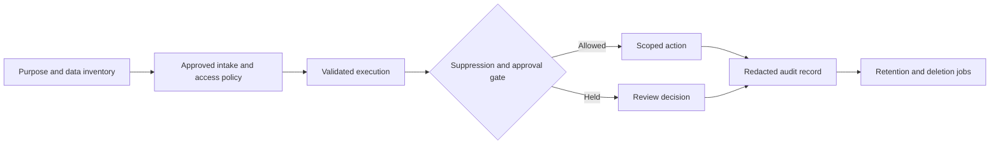

# Security, compliance, and data governance

Governance defines what data a commercial workflow may process, which systems can act, who can inspect or change records, and how long evidence is retained. Translate requirements into controls at the point of action. Associate each control with an owner and a way to test it.

## Reference architecture

## Tutorial · Exercise suppression and deletion

1. Create an inventory for the hypothetical demo workflow. For each field, record its purpose, authority, classification, access group, and retention trigger. Put credentials in an approved secret store and use separate test credentials.
2. Run `python examples/gtm_lab.py routing`. Find the suppressed decision and verify the event has no task. In a fixture copy, add a second eligible signal type for that account and confirm it is still blocked.
3. Design an action-time suppression check to cover changes between decision and delivery. Restrict the sender to only the approved CRM properties or task operation. A reviewed override should capture an actor, reason, and expiry.
4. Walk through a hypothetical deletion request. Locate the account's data in sources, staging, the CRM, exports, and logs. Define who authorizes and verifies deletion, how backups expire, and which minimum operational records still have an approved purpose.

Use the [operational checklists](checklists.md) in design review. Have the designated legal or privacy owner translate applicable law and contract terms into requirements for the specific data and jurisdictions.

## Common failure modes

| Symptom | Remedy |
| --- | --- |
| A deleted or suppressed record reappears after replay | Apply current policy before side effects and coordinate replay with retention and deletion controls. |
| Debug logs contain full provider payloads | Log IDs, reason codes, and redacted fields. Test log output with representative fixtures. |
| A shared integration credential has broad privileges | Scope permissions by runtime role, audit use, and rotate credentials on a defined schedule. |

## Primary sources

- Data processing, inventories, and privacy risk. [NIST Privacy Framework](https://www.nist.gov/privacy-framework)
- Risk controls and evaluation for AI-enabled workflows. [NIST AI RMF](https://www.nist.gov/itl/ai-risk-management-framework)
- Prompt injection, information disclosure, and excessive agency. [OWASP Top 10 for LLM applications](https://owasp.org/projects/top-10-for-large-language-model-applications)
