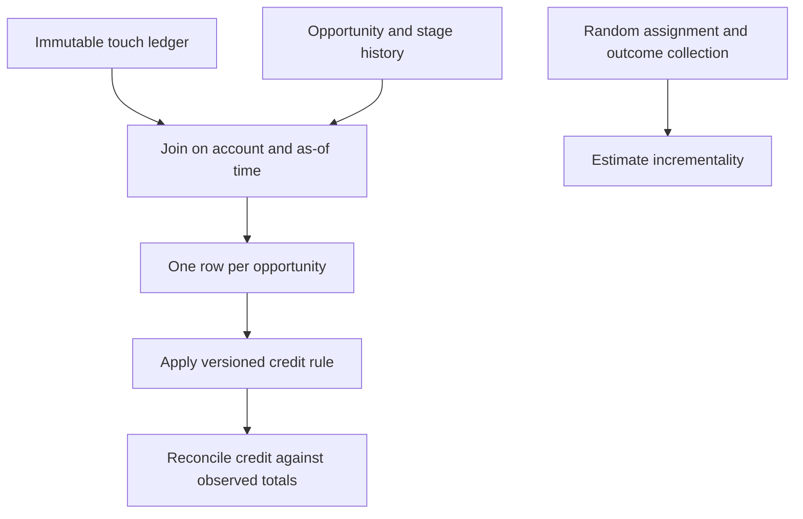

# Pipeline measurement and attribution

Pipeline measurement tracks commercial progress at a defined grain, such as one created opportunity per account within a period. Attribution allocates an observed outcome across prior touches under a written rule. An incrementality experiment estimates the difference caused by an intervention. Keep the generated credit, the observed pipeline, and the experiment estimate as distinct measures.

## Reference architecture

## Exercise · Reconcile two credit rules

Use this synthetic ledger. Treat the rows as UTC dates and give pre-creation touches a 30-day lookback. Opportunity amount is open pipeline in USD.

| Account | Record | Date | Channel or amount |
| --- | --- | --- | --- |
| account-101 | Touch | 2026-11-01 | Partner referral |
| account-101 | Touch | 2026-11-12 | Demo request |
| account-101 | Opportunity opp-01 | 2026-11-15 | 1,200 USD |
| account-202 | Touch | 2026-10-01 | Community |
| account-202 | Opportunity opp-02 | 2026-11-16 | 800 USD |
| account-202 | Touch | 2026-11-17 | Demo request |

1. Build one row per opportunity and collect only touches before creation within the lookback. Record “unattributed” when the set is empty. The ledger (business event table) needs a stable touch ID and source timestamp in a live implementation.
2. Under first-touch credit, referral gets $1,200 and unattributed gets $800. Under last-touch credit, demo request gets $1,200 and unattributed gets $800. Both sum to $2,000. A reporting snapshot must preserve which rule was used.
3. Compare this with `python examples/gtm_lab.py measurement`. Find the 25-percentage-point difference between the synthetic trial groups. Write the unit and denominator for each calculation. Credit uses created opportunities and allocates observed dollars. The trial uses assigned accounts and compares observed rates.
4. For a follow-up experiment, predefine assignment, enrollment, the outcome window, and how you would flag missing opportunity IDs. Check allocation counts against the expected group ratio before interpreting effects.

## Common implementation failures

| Failure | Recovery |
| --- | --- |
| A deal appears once for every touch in a pipeline report | Aggregate after allocating credit and reconcile to one source total by opportunity. |
| A touch after the outcome receives credit | Apply as-of joins using occurrence time and document the late-arrival policy. |
| Higher channel credit is interpreted as higher lift | Use consistent assignment and a control group for causal decisions. |

## Primary references

- Assignment and instrumentation errors in controlled experiments. [Microsoft Research on sample ratio mismatch](https://www.microsoft.com/en-us/research/publication/diagnosing-sample-ratio-mismatch-in-online-controlled-experiments-a-taxonomy-and-rules-of-thumb-for-practitioners/)
- Event and relationship design for pipeline grain. [HubSpot CRM model](https://developers.hubspot.com/docs/api-reference/latest/crm/understanding-the-crm)
