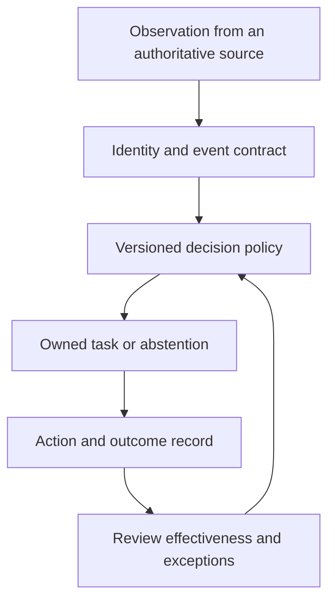

# Model a commercial system

A commercial system connects an observation, a decision, a person or service that can act, and a measured result. Write down the boundary around those four things. A service may own the truth about a subscription while a different team owns whether that fact warrants a handoff. The proposed framework for making those boundaries explicit is described in [Research](../research/index.md).

## Reference architecture

## Exercise · Follow the demo request

1. Run `python examples/gtm_lab.py routing` from the repository root with Python 3.11+. Trace `demo-101` from the intake envelope to its local task. Write down the source, business identity, reason, and owner in four columns.
2. In a copy of `examples/fixtures`, set the account owner to null and rerun `python examples/gtm_lab.py routing --fixtures PATH`. Expect a recorded decision with reason `missing_owner_or_crm_id` and no task for `demo-101`.
3. Draw the same boundary for a handoff you operate. Specify the human who handles the exception and the event that confirms the requested work happened. For a spike in missing owners, identify one metric and one trace or log field you need to diagnose it.

A useful design review artifact is the diagram plus an example showing how the same event leads to an exception when reference data changes. Name the authority for both event and reference data.

## Common implementation failures

| Failure | Recovery |
| --- | --- |
| The CRM label and billing status disagree | Trace the authority for each fact. Preserve both timestamps and map them to one business decision. |
| An event was processed but no owner acted | Measure the separately observed outcome and make the exception queue visible. |
| An inherited policy has no owner | Add an approved version and a reviewer who can decide on a rollback. |

## Primary references

- Event identity and time. [CloudEvents 1.0.2](https://github.com/cloudevents/spec/blob/v1.0.2/cloudevents/spec.md)
- Visibility across execution boundaries. [OpenTelemetry signals](https://opentelemetry.io/docs/concepts/signals/)
