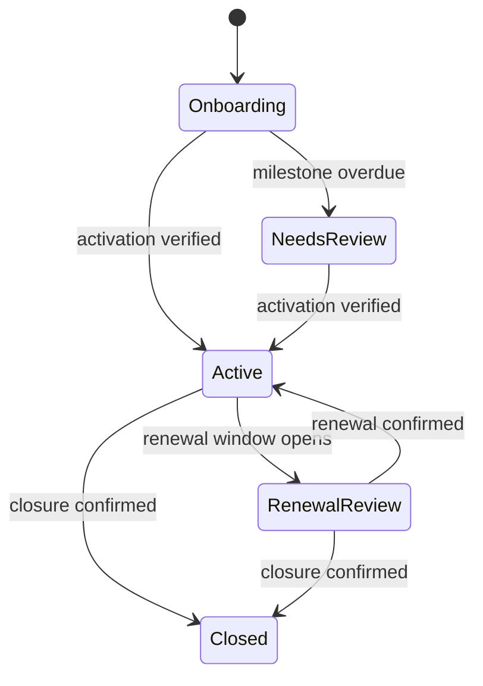

# Customer lifecycle engineering

Lifecycle workflows turn customer milestones into owned follow-up. An account can be in onboarding while its subscription is active and a renewal opportunity is open. Model these dimensions separately, then translate meaningful transitions into specific work for the responsible team.

## Reference architecture

## Tutorial · Route a missed onboarding milestone

1. Define the milestone with a source and deadline. In the hypothetical lab workflow, `onboarding.milestone_due` requests an internal follow-up and carries the account ID. Give workflow ownership to the designated onboarding team.
2. Run `python examples/gtm_lab.py routing`. Find the proposed `review_onboarding_milestone` task. Confirm that its owner and CRM ID came from the account snapshot.
3. Duplicate the event in a copied fixture and rerun with `--fixtures PATH`. The same delivery still yields one task. In a real scheduler, give each milestone instance a stable ID and cancel outstanding reminders when activation or closure arrives.
4. Write transition tests for delayed activation, a corrected event, a reopened account, and a missing owner. Specify event time, previous state, and the desired next state for each case.

Measure the share of eligible accounts that activate within the onboarding window. Segment by cohort start and watch task backlog and false escalations.

## Common failure modes

| Symptom | Remedy |
| --- | --- |
| A renewal task appears for a closed account | Verify current status at action time and define closure as an explicit terminal state. |
| Lifecycle stage means different things to different teams | Define separate axes for engagement, billing, and pipeline. Give each axis an authority and transition rules. |
| One customer receives repeated handoffs | Deduplicate by account, milestone instance, and action type. |

## Primary sources

- Subscription lifecycle event types and delivery behavior. [Stripe Billing webhooks](https://docs.stripe.com/billing/subscriptions/webhooks)
- CRM object and record relationships. [HubSpot CRM model](https://developers.hubspot.com/docs/api-reference/latest/crm/understanding-the-crm)
