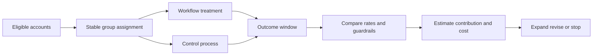

# Measurement, experimentation, and ROI

A workflow is valuable when it improves a business outcome at an acceptable cost and error rate. Separate execution volume, operational impact, and downstream value. Define the decision unit and outcome window before launch so a change in activity can be interpreted.

## Reference architecture

## Tutorial · Calculate the value of a routing trial

1. Choose the account as the assignment unit when contacts share account ownership. Define eligibility and a fixed outcome window. Count assigned accounts even if the workflow fails to reach them.
2. Run `python examples/gtm_lab.py measurement`. The synthetic treatment converts two of four accounts. Control converts one of four. Absolute lift is 25 percentage points.
3. Recreate the worksheet. Estimated incremental conversions equal absolute lift multiplied by treatment accounts, which gives one conversion. At $200 contribution per conversion and $100 workflow cost, illustrative ROI is `(200 - 100) / 100 = 100%`. Include provider, compute, and reviewer time in a real workflow's incremental cost.
4. Change a control conversion to true in a fixture copy. The observed difference becomes zero. Before doing a live trial, define guardrails such as false routing, review backlog, and opt-outs. Plan sample size, uncertainty reporting, duration, and stopping rules in advance.

A sample ratio mismatch is a discrepancy between expected and observed group allocation. Investigate assignment and logging before interpreting effects. A tiny fixture teaches the arithmetic and leaves causal inference to a properly designed trial.

## Common failure modes

| Symptom | Remedy |
| --- | --- |
| Several contacts on one account fall into different groups | Assign consistently at the account level and analyze using that unit. |
| The dashboard excludes runs with errors | Preserve the assigned population and record missing outcomes explicitly. |
| Revenue is counted as profit | Use contribution after variable delivery costs and include the full incremental workflow cost. |

## Primary sources

- Assignment and telemetry failure diagnostics. [Microsoft Research on sample ratio mismatch](https://www.microsoft.com/en-us/research/publication/diagnosing-sample-ratio-mismatch-in-online-controlled-experiments-a-taxonomy-and-rules-of-thumb-for-practitioners/)
- Original papers on experiment design and metric interpretation. [Microsoft Experimentation Platform publications](https://www.microsoft.com/en-us/research/group/experimentation-platform-exp/publications/)
