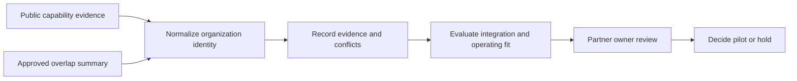

# Partnership intelligence

Partnership intelligence helps a team decide which organizations to evaluate for integrations, co-selling, referral, or distribution. Start with evidence of a shared customer need, complementary capability, and a feasible operating relationship. Keep the proposed relationship type explicit because each one calls for different evidence.

## Reference architecture

## Tutorial · Prepare a partner review brief

1. Write a hypothesis for a synthetic integration partner. Record the shared workflow, intended user, complementary capability, and a falsifying condition such as unavailable API access.
2. Create an evidence row per claim with `subject`, `source_url`, `retrieved_at`, `verdict`, and `notes`. Public repositories can indicate maintenance or integration activity. Record evidence of willingness to partner separately.
3. Run `python examples/gtm_lab.py intelligence`. Trace why `partner-review` is eligible for a human reviewer. Add a second evidence observation with verdict `contradicts`, link it to that proposal, and rerun with `--fixtures PATH`. The proposal should be held.
4. Hand the reviewer a one-page brief with evidence, gaps, and a proposed pilot. For a co-sell review, use only approved aggregate overlap results and document their population, period, and match rules.

Assess partnership pilots by qualified joint opportunities or successful integration use, according to the relationship type. Define an owner on each side before measuring handoffs.

## Common failure modes

| Symptom | Remedy |
| --- | --- |
| Shared parent and subsidiary accounts inflate overlap | Normalize entities, document the reporting grain, and review ambiguous matches. |
| A busy repository is interpreted as partnership intent | Treat activity as evidence about capability and seek direct confirmation of intent. |
| Spreadsheets of prospects circulate before agreement | Approve data fields and purpose before any sharing. Use aggregated overlap where it answers the question. |

## Primary sources

- Authorized repository metadata surfaces. [GitHub REST repository documentation](https://docs.github.com/en/rest/repos/repos)
- Privacy risk management and data processing. [NIST Privacy Framework](https://www.nist.gov/privacy-framework)
