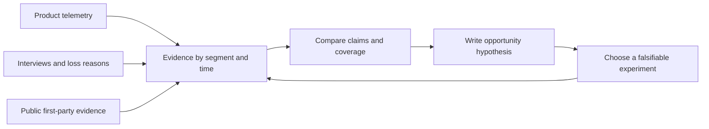

# Product-market intelligence

Product-market intelligence turns product usage, customer research, sales outcomes, and market evidence into decisions about which problems and segments to pursue. Keep observations at their native grain. One account interview, a user event, and a public filing convey different information and cover different populations.

## Reference architecture

## Tutorial · Turn a market claim into a test

1. Choose a decision and write a falsifiable statement. **Example hypothesis.** Teams with recurring manual reconciliation adopt a reconciliation feature faster than otherwise comparable teams. Specify who qualifies, the adoption event, and the observation window.
2. Build a small evidence ledger that captures source type, segment, date, interpretation, and counterevidence. Preserve the sample denominator for usage or survey data. Keep statement counts separate from the number of distinct customers.
3. Run `python examples/gtm_lab.py intelligence`. Find `product-market-review` and examine why contradictory observations hold the proposal. In a copied fixture, add your own synthetic counterexample and document the reviewer decision.
4. Select a test that can change the product decision. For example, show a prototype to eligible teams with and without the hypothesized pain and apply the same observable task and scoring criteria to each group.

Include the observation and its interpretation in the brief. A filing can indicate a named risk or priority for a reporting issuer. Coverage and definitions determine how far you can generalize it.

## Common failure modes

| Symptom | Remedy |
| --- | --- |
| Interview code counts are interpreted as segment prevalence | Report sampling and nonresponse. Use a representative design where prevalence matters. |
| Product adoption changes after instrumenting a new event | Version event definitions and compare only compatible cohorts. |
| Every source appears to corroborate the idea | Track whether sources share the same underlying evidence and actively seek counterexamples. |

## Primary sources

- Public filer submissions and financial statement data. [SEC EDGAR API documentation](https://www.sec.gov/search-filings/edgar-application-programming-interfaces)
- Design and interpretation of controlled online experiments. [Microsoft Experimentation Platform publications](https://www.microsoft.com/en-us/research/group/experimentation-platform-exp/publications/)
