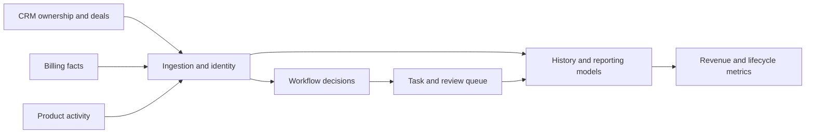

# Revenue operations architecture

Revenue operations architecture connects selling, onboarding, retention, and reporting while preserving the decisions each system owns. A CRM can own deal stage and assigned seller while billing owns subscription status and a warehouse owns reporting models. Set authority at the field or event level so operational views can be rebuilt and corrected.

## Reference architecture

## Tutorial · Define authority before syncing

1. Pick an organizational account as the reporting grain. Create an identity mapping from source system and source record ID to the internal account ID. Route disputed mappings for review before writing account changes.
2. Make an authority table. For a hypothetical workflow, assign `account.owner` to CRM, `subscription.status` to billing, and `activation.first_qualified_event_at` to product telemetry. Store observed timestamps and source IDs for reconstruction.
3. Run `python examples/gtm_lab.py routing`. Inspect the task owner and use the routing fixture to trace it to the account snapshot. Copy the fixtures, change an eligible account's owner, and rerun. The same source event can produce a different assignment in a new run because you changed the reference state.
4. For real reporting, keep event time and ingestion time separate. Define a reconciliation report for unmatched IDs, contradictory authority, and source-to-target lag.

At review, identify the business owner of each field and what a downstream system should do when the value is absent.

## Common failure modes

| Symptom | Remedy |
| --- | --- |
| The same update bounces between systems | Enforce single authority per field and attach provenance to integration writes. |
| Months of historic reports change after a current CRM edit | Keep effective-dated snapshots or an append-only history for fields used in time-based reporting. |
| Parent and subsidiary activity is counted twice | Publish the account grain and explicit parent-child aggregation rules. |

## Primary sources

- CRM objects, records, properties, and relationships. [HubSpot CRM model](https://developers.hubspot.com/docs/api-reference/latest/crm/understanding-the-crm)
- Uniqueness and relationship constraints. [PostgreSQL constraints](https://www.postgresql.org/docs/current/ddl-constraints.html)
