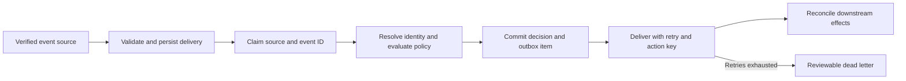

# Buying signals and event-driven workflows

A buying signal is an observation used to prioritize a commercial decision. A direct demo request has a clearer connection to the requested action than a hiring announcement. Capture event provenance and timing so a policy can distinguish intent, fit, eligibility, and freshness.

## Reference architecture

## Tutorial · Replay a signal safely

1. Compare `examples/config/signal.schema.json` with one event in `examples/fixtures/routing.json`. The lab uses a constrained CloudEvents envelope. The producer's `source` and `id` form the duplicate key.
2. Run `python examples/gtm_lab.py routing`. Seven deliveries yield one duplicate and two proposed tasks. Locate the signal held for being outside its freshness window.
3. Copy the fixture folder, duplicate one of the accepted deliveries, and pass the copy via `--fixtures PATH`. Duplicate count increases while decision and task counts remain stable.
4. Design the live adapter. Verify the delivery signature where supported, persist intake before acknowledging, and commit the decision plus an outbox row in one transaction. The outbox worker sends the agreed action, records its remote ID, and checks for an existing effect before retrying an uncertain result. Use a downstream idempotency key where the endpoint supports one.

Use bounded exponential backoff with jitter for transient errors and a dead-letter queue for exhausted or invalid events. Keep deduplication history long enough for the supported replay window. Monitor event age and the oldest unsettled action.

## Common failure modes

| Symptom | Remedy |
| --- | --- |
| Duplicates appear after network timeouts | Bind the downstream effect to a stable action key and reconcile uncertain writes. |
| Late updates reopen closed work | Compare source occurrence time with current state and enforce allowed transitions. |
| Low-quality signals flood sellers | Add freshness, evidence, account eligibility, and caps before routing. |

## Primary sources

- Event envelope and duplicate identity. [CloudEvents 1.0.2 specification](https://github.com/cloudevents/spec/blob/v1.0.2/cloudevents/spec.md)
- Provider retry and verification behavior. [Stripe webhooks](https://docs.stripe.com/webhooks)
