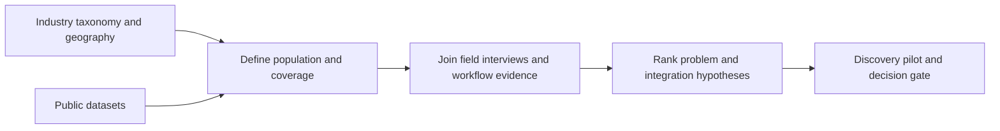

# Vertical opportunity intelligence

Vertical opportunity intelligence evaluates a specific industry and workflow. A credible opportunity brief defines who experiences the problem, who controls the budget, what systems are used, and where the evidence is thin. Industry classifications help estimate coverage and compare segments. They leave workflow pain and willingness to pay to direct validation.

## Reference architecture

## Tutorial · Frame a defensible vertical brief

1. Pick one workflow and geography. Start with the U.S. Census NAICS classification guide and record a relevant code and edition. Document organizations the code includes and excludes.
2. In County Business Patterns, select one release year and geography. Record the reporting unit and suppression rules. Establishment counts can bound the number of employer locations in the covered data. A multi-location firm can contribute several establishments.
3. Run `python examples/gtm_lab.py intelligence`. Inspect why `vertical-review` is held for stale evidence. Add a synthetic discovery note with a recent policy-relative timestamp and verify how the status changes when you link it.
4. Create a brief with the covered population, recurring problem, buyer role, system of record, integration constraint, and disconfirming evidence. Interview practitioners from different organization sizes and document the selection method.

**Example hypothesis.** Multi-site operators in the chosen segment have a harder time reconciling the target records than single-site operators. Test this with the same workflow walkthrough and time unit across both groups.

## Common failure modes

| Symptom | Remedy |
| --- | --- |
| Establishment counts appear in a model as unique buyers | Preserve the reporting unit and measure purchasing authority separately. |
| Two benchmark years use different classification codes | Document the code vintage and use comparable codes or a reviewed crosswalk. |
| Public sources describe the industry but miss the daily work | Validate the specific handoff through observation or interviews before building. |

## Primary sources

- Classification hierarchy and 2022 sector definitions. [U.S. Census guide to NAICS](https://www.census.gov/programs-surveys/economic-census/year/2022/guidance/understanding-naics.html)
- Release files and coverage. [U.S. Census County Business Patterns data](https://www.census.gov/programs-surveys/cbp/data.html)
