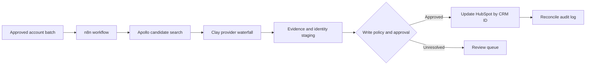

# n8n, Clay, Apollo, and HubSpot workflows

One practical arrangement uses n8n for orchestration, Clay for enrichment waterfalls, Apollo for a scoped candidate search or enrichment step, and HubSpot as the CRM. Define the interface between each tool before connecting them. Inputs should include identifiers and purpose, while outputs should preserve provenance, match state, and the fields the consumer can use.

The included n8n Code node decision logic was executed locally. The editor import and account-dependent pilot below require verification in the reader’s approved test environment.

## Reference architecture

## Tutorial · Import and dry-run the workflow

1. In an n8n editor, open the workflow menu, choose **Import from File**, and import `examples/n8n/signal-triage.json`. Leave it available for manual execution.
2. Execute it and inspect the **Decide Task Proposals** node. The output contains four items in order, `route_review_task`, `duplicate`, `blocked`, and `manual_review`. Neither node uses credentials or sends requests.
3. In a controlled pilot, use a small approved batch. In Apollo People API Search, scope candidate discovery to the target organization and role. Carry the returned person ID into staging. This search surface omits email and phone. Use People Enrichment only for fields needed and permitted by the workflow.
4. In the Clay table, add a waterfall for one approved field. Set the run condition to require an approved row and a missing target value. Inspect the selected provider, observed value, and cost before bulk execution. Send conflicting results to review.
5. In a HubSpot test account, create a text company property named `gtm_lab_evidence_status`, then choose one synthetic company and confirm its CRM ID. With a test credential authorized for company writes, patch `/crm/objects/2026-09/companies/{companyId}` with `{"properties":{"gtm_lab_evidence_status":"reviewed"}}`. Read the company back and confirm that only the designated field was patched. Save the action key, outcome, and CRM ID in the workflow audit log. Confirm that an ambiguous match and a suppressed record skip the write.

### Sample staging contract

| Field | Example | Consumer rule |
| --- | --- | --- |
| `account_id` | `account-101` | Internal identity supplied by the approved batch |
| `provider_person_id` | `synthetic-person-101` | Evidence reference scoped to the provider |
| `crm_company_id` | `synthetic-101` | Resolved company ID required for a write |
| `candidate_field` and `candidate_value` | `employee_band`, `11–50` | Keep provider evidence in staging until policy approves its use |
| `source` and `observed_at` | `provider-a`, `2026-11-19T13:00:00Z` | Record provenance and compare freshness |
| `match_status` and `review_status` | `unique`, `approved` | Require both before rechecking suppression and applying the allowlisted write |

The n8n example deduplicates within one run. A production workflow needs persistent event claims, durable failure handling, and scoped credentials. The [event tutorial](signals.md) shows where those guarantees belong.

## Common failure modes

| Symptom | Remedy |
| --- | --- |
| A scheduled import consumes unexpected provider credits | Filter to approved rows before enrichment, cap volume, and review unit cost and accepted match rate. |
| Every replay updates the CRM | Persist an action key and reconcile the remote state before retrying. |
| Workflow sharing exposes credentials | Inspect exports for credential names, IDs, and headers before sharing. |

## Primary sources

- JSON workflow import and export. [n8n docs](https://docs.n8n.io/build/manage-workflows/export-and-import.md)
- Fallback between providers. [Clay waterfalls](https://university.clay.com/docs/building-a-data-waterfall)
- Candidate discovery and field retrieval. [Apollo People API Search](https://docs.apollo.io/reference/people-api-search) · [Apollo People Enrichment](https://docs.apollo.io/reference/people-enrichment)
- API generation and the company property update. [HubSpot API reference](https://developers.hubspot.com/docs/api-reference/latest/overview) · [Update a company](https://developers.hubspot.com/docs/api-reference/latest/crm/objects/companies/update-company)
